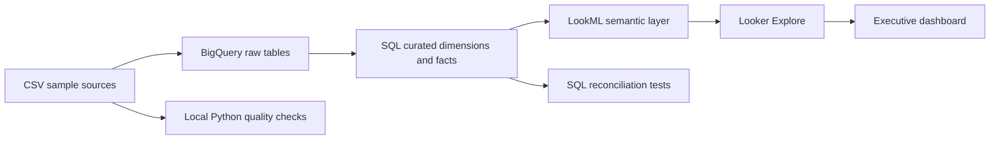

# Enterprise Retail Analytics & BI Platform

A **reproducible portfolio project** demonstrating retail dimensional modeling, Google BigQuery SQL, LookML semantic modeling, data quality tests, and an executive BI dashboard specification. Built with **synthetic data**; no private customer information.

> **Project status:** Source-controlled reference implementation. SQL and Python tests can be run; LookML and dashboard assets are ready for import into a configured Looker instance, but no live Looker deployment or performance benchmark is claimed. Screenshots must come from an actual deployment.

## Architecture



## Repository map

| Path | Contents |
|---|---|
| `data/` | Deterministic synthetic CSVs: orders, order items, customers, products |
| `sql/` | BigQuery DDL, curated models, business KPI examples |
| `looker/` | LookML model, views, joins, metrics and dashboard definition |
| `validation/` | BigQuery assertions for keys, relationships, and metric reconciliation |
| `scripts/` | Dependency-free local CSV quality checker |
| `tests/` | Automated tests for sample data and business logic |
| `docs/` | Architecture, metric dictionary, modeling and deployment instructions |
| `dashboards/` | Dashboard wireframe and build guide (not fabricated screenshots) |

## Quick start: run checks locally

```bash
python3 -m unittest discover -s tests -v
python3 scripts/validate_data.py
```

Both commands use only the Python standard library.

## Deploy to BigQuery and Looker

1. Create a Google Cloud project and a BigQuery dataset named `retail_raw` and `retail_analytics` (or change the SQL identifiers).
2. Load the four CSVs into corresponding `retail_raw` tables. Set `order_date` as `DATE`; IDs and status as `STRING`; quantities as `INT64`; unit prices and costs as `NUMERIC`.
3. Run `sql/01_curated_tables.sql` after replacing `YOUR_GCP_PROJECT` with your project ID.
4. Run `validation/bigquery_assertions.sql` and `sql/02_kpi_examples.sql`.
5. Configure a **BigQuery connection named `retail_bigquery`** in Looker. Import `looker/` into a LookML project, change `YOUR_GCP_PROJECT` in the view SQL table names, validate LookML, then deploy.
6. Open the `Order Items` Explore and build the dashboard according to `dashboards/dashboard_build_guide.md`. The LookML dashboard file is a starter definition; verify it in your own instance.

**Costs:** BigQuery and Looker may incur charges. Use a small project, billing alerts, and appropriate access permissions. Looker requires an eligible instance; this repository does not include Looker licensing or a hosted dashboard.

## Metrics and modeling choices

- **Sales revenue:** sum of `quantity * unit_price` for **completed** orders only; excludes tax, shipping, discounts and returns (not present in this synthetic dataset).
- **Gross profit:** sum of `quantity * (unit_price - unit_cost)` for completed orders.
- **Order count:** `COUNT(DISTINCT order_id)`; item-level rows must not be counted as orders.
- **AOV:** revenue divided by distinct completed orders; never the average of line item prices.
- **Fact grain:** exactly one row per order item (`order_item_id`).
- **Join safety:** dimension tables have unique business keys; joins from fact to dimension are many-to-one.

See [metric definitions](docs/metric_dictionary.md), [architecture](docs/architecture.md), and [deployment guide](docs/deployment.md).

## Portfolio integrity

This repository proves the code and local tests that are checked in. It does **not** prove that a live Looker dashboard was deployed, that access controls were configured, or that query costs improved. Add verified screenshots, benchmark results and your GitHub URL only after completing those steps.

## License

MIT; see `LICENSE`.
